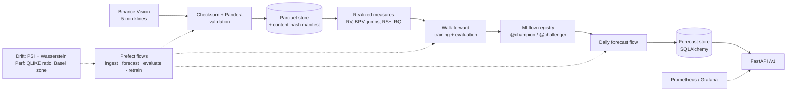

# Crypto Volatility Forecasting

[](https://github.com/Hitesh-Prajapathi/crypto-volatility-forecasting/actions/workflows/ci.yml)


Forecasting the **daily realized variance** of BTC, ETH and SOL from 5-minute Binance bars, evaluated honestly and served from a production-style MLOps stack.

- **Research:** 16 models, from naive and GARCH through the HAR-RV family to LightGBM/XGBoost and ensembles. Each is evaluated in an expanding walk-forward over 1,900–2,100 out-of-sample days per asset. The tests are QLIKE, Diebold-Mariano (HLN-corrected), Mincer-Zarnowitz and the Model Confidence Set. The variance forecasts are turned into VaR/ES and backtested with Kupiec, Christoffersen, the Basel traffic light and Acerbi-Székely.
- **Engineering:** a Binance data pipeline with checksum verification and schema validation, and leakage guards enforced by property tests. Model governance runs through MLflow, using aliases and a statistical promotion gate. Prefect runs the daily flows, with drift and performance monitoring, and a FastAPI service serves forecasts from a forecast store. Packaging covers Docker, Helm/Argo CD manifests, Prometheus/Grafana, and GitHub Actions CI/CD.

> **Earlier results were retracted.** The first version of this project reported numbers that were invalid: the target leaked into the features, there was no forward shift, and the scaler was fit on test data. The audit is in [ADR-0002](docs/adr/0002-legacy-results-retracted.md). The original code is kept at tag `v0-legacy` and in [`legacy/`](legacy/README.md).

## Results

The headline numbers below are the full walk-forward from 2021-01-01 to 2026-11-12, on data through 2026-11-13. The models are refit on an expanding window with a 365-day minimum. The loss is QLIKE on variance; a ratio below 1 beats the benchmark. The p-values come from a one-sided HLN-corrected Diebold-Mariano test of "the model beats the benchmark". MCS is the 90% Model Confidence Set.

**1-day ahead (h=1)**

| model | BTC vs HAR | BTC vs log-HAR-DoW (p) | ETH vs HAR | ETH vs log-HAR-DoW (p) | SOL vs HAR | SOL vs log-HAR-DoW (p) |
|---|---|---|---|---|---|---|
| GARCH(1,1)-t | 1.081 | 1.335 | 1.118 | 1.456 | 0.966 | 1.372 |
| log-HAR | 0.917 | 1.132 | 0.838 | 1.092 | 0.758 | 1.076 |
| **log-HAR + weekend (log-HAR-DoW)** | 0.810 | — | 0.768 † | — | 0.704 † | — |
| LightGBM | 0.740 | 0.913 (0.002) | 0.738 † | 0.962 (0.23) | 0.688 † | 0.977 (0.22) |
| **XGBoost** | **0.717** † | **0.885 (0.0002)** | **0.710** † | 0.925 (0.045) | **0.684** † | 0.971 (0.16) |

**5-day ahead (h=5)**

| model | BTC vs HAR | BTC vs log-HAR-DoW (p) | ETH vs HAR | ETH vs log-HAR-DoW (p) | SOL vs HAR | SOL vs log-HAR-DoW (p) |
|---|---|---|---|---|---|---|
| log-HAR-DoW | 0.837 † | — | 0.774 † | — | 0.695 † | — |
| XGBoost | 0.799 † | 0.955 (0.26) | 0.757 † | 0.979 (0.38) | 0.767 | 1.104 (0.997) |

† in the 90% MCS. HAR itself is never in the MCS.

**What the results say**

1. Every serious model beats HAR, and XGBoost cuts 1-day QLIKE by about 28–32%.
2. **Most of that gain is a calendar effect.** BTC's weekend realized variance is about half of its weekday level. Adding a weekend term to log-HAR captures much of the gain at 1-day, and at 5-day it is statistically indistinguishable from XGBoost or better. That's why log-HAR-DoW is reported as a second, fairer benchmark.
3. Against that benchmark, XGBoost's edge is significant only at 1-day on BTC (p = 0.0002), and marginally on ETH (p = 0.045). At 5-day on SOL the linear model is better.
4. **VaR:** the 99% 1-day VaR built with filtered historical simulation is close to nominal for XGBoost: 1.03% / 0.98% / 1.04% breaches on BTC / ETH / SOL. It passes Kupiec and Christoffersen, with a green Basel zone. Gaussian VaR on the same forecasts over-breaches on BTC and ETH (1.49% and 1.87%), because 5-minute realized variance is not on the same scale as close-to-close variance.

<details>
<summary>Full generated tables (all 16 models, by year, by volatility regime, VaR/ES at 1% and 5%)</summary>


<!-- RESULTS:START -->
# Out-of-sample results

Walk-forward, expanding window, first origin 2021-01-01, min_train 365; benchmark HAR; QLIKE on variance (lower is better); ratio < 1 beats HAR. Models are compared on common valid origins (n shown per table). DM: one-sided HLN-corrected Diebold-Mariano p-value for 'model beats HAR'. MCS: Hansen-Lunde-Nason model confidence set at the 90% level (1000 bootstrap reps, seed 0). Where present, 'ratio vs log_har_dow' is the model's mean QLIKE divided by log_har_dow's and 'DM p (beats log_har_dow)' the one-sided HLN Diebold-Mariano p-value for 'model beats log_har_dow', on the same common origins (shown as - on the log_har_dow row).

## BTCUSDT

### h=1 (n=2135, origins 2021-01-01 to 2026-11-12)

| model | QLIKE | ratio vs HAR | DM p (beats HAR) | ratio vs log_har_dow | DM p (beats log_har_dow) | MSE | MZ R2 | MZ Wald p | MCS 90% |
|---|---|---|---|---|---|---|---|---|---|
| naive | 0.4964 | 1.368 | 1.000 | 1.690 | 1.000 | 6.075e-06 | 0.160 | 0.000 | no |
| ewma | 0.4138 | 1.141 | 0.943 | 1.409 | 1.000 | 4.340e-06 | 0.157 | 0.042 | no |
| ewma_rv | 0.4008 | 1.105 | 0.953 | 1.365 | 1.000 | 4.242e-06 | 0.166 | 0.534 | no |
| garch | 0.3921 | 1.081 | 0.999 | 1.335 | 1.000 | 4.266e-06 | 0.166 | 0.000 | no |
| gjr_garch | 0.3976 | 1.096 | 0.999 | 1.354 | 1.000 | 4.334e-06 | 0.151 | 0.001 | no |
| har (benchmark) | 0.3628 | 1.000 | - | 1.235 | 0.995 | 4.072e-06 | 0.211 | 0.000 | no |
| log_har | 0.3326 | 0.917 | 0.137 | 1.132 | 1.000 | 3.801e-06 | 0.253 | 0.177 | no |
| har_dow | 0.3780 | 1.042 | 0.921 | 1.287 | 0.996 | 4.144e-06 | 0.207 | 0.000 | no |
| log_har_dow | 0.2937 | 0.810 | 0.005 | - | - | 3.733e-06 | 0.266 | 0.322 | no |
| har_cj | 0.3726 | 1.027 | 1.000 | 1.268 | 0.998 | 4.299e-06 | 0.195 | 0.000 | no |
| shar | 0.4036 | 1.112 | 0.921 | 1.374 | 0.998 | 4.730e-06 | 0.158 | 0.000 | no |
| harq | 0.3305 | 0.911 | 0.000 | 1.125 | 0.940 | 4.051e-06 | 0.226 | 0.000 | no |
| lgbm | 0.2683 | 0.740 | 0.000 | 0.913 | 0.002 | 3.940e-06 | 0.243 | 0.000 | no |
| xgb | 0.2599 | 0.717 | 0.000 | 0.885 | 0.000 | 3.855e-06 | 0.254 | 0.000 | yes |
| ens_eq | 0.2934 | 0.809 | 0.000 | 0.999 | 0.491 | 3.851e-06 | 0.250 | 0.004 | no |
| ens_inv | 0.2907 | 0.801 | 0.000 | 0.990 | 0.408 | 3.847e-06 | 0.251 | 0.005 | no |

### h=5 (n=2103, origins 2021-01-01 to 2026-11-08)

| model | QLIKE | ratio vs HAR | DM p (beats HAR) | ratio vs log_har_dow | DM p (beats log_har_dow) | MSE | MZ R2 | MZ Wald p | MCS 90% |
|---|---|---|---|---|---|---|---|---|---|
| naive | 0.8464 | 3.082 | 0.999 | 3.682 | 1.000 | 1.070e-04 | 0.210 | 0.000 | no |
| ewma | 0.3015 | 1.098 | 0.782 | 1.312 | 1.000 | 4.710e-05 | 0.250 | 0.015 | no |
| ewma_rv | 0.2687 | 0.979 | 0.406 | 1.169 | 0.990 | 4.717e-05 | 0.256 | 0.050 | no |
| garch | 0.2588 | 0.942 | 0.063 | 1.126 | 0.913 | 4.614e-05 | 0.257 | 0.001 | no |
| gjr_garch | 0.2626 | 0.956 | 0.156 | 1.143 | 0.934 | 4.714e-05 | 0.240 | 0.009 | no |
| har (benchmark) | 0.2746 | 1.000 | - | 1.195 | 0.953 | 4.524e-05 | 0.297 | 0.000 | no |
| log_har | 0.2449 | 0.892 | 0.143 | 1.066 | 1.000 | 4.008e-05 | 0.368 | 0.016 | no |
| har_dow | 0.2672 | 0.973 | 0.000 | 1.163 | 0.918 | 4.490e-05 | 0.302 | 0.000 | no |
| log_har_dow | 0.2298 | 0.837 | 0.047 | - | - | 3.959e-05 | 0.376 | 0.022 | yes |
| har_cj | 0.2822 | 1.028 | 1.000 | 1.228 | 0.973 | 4.699e-05 | 0.288 | 0.000 | no |
| shar | 0.2711 | 0.987 | 0.015 | 1.179 | 0.942 | 4.686e-05 | 0.276 | 0.000 | no |
| harq | 0.2604 | 0.948 | 0.000 | 1.133 | 0.884 | 4.420e-05 | 0.314 | 0.000 | no |
| lgbm | 0.2289 | 0.834 | 0.001 | 0.996 | 0.477 | 4.229e-05 | 0.354 | 0.003 | no |
| xgb | 0.2195 | 0.799 | 0.000 | 0.955 | 0.258 | 4.052e-05 | 0.370 | 0.004 | yes |
| ens_eq | 0.2246 | 0.818 | 0.000 | 0.977 | 0.394 | 4.037e-05 | 0.366 | 0.000 | yes |
| ens_inv | 0.2252 | 0.820 | 0.000 | 0.980 | 0.400 | 4.038e-05 | 0.365 | 0.000 | yes |

## ETHUSDT

### h=1 (n=2135, origins 2021-01-01 to 2026-11-12)

| model | QLIKE | ratio vs HAR | DM p (beats HAR) | ratio vs log_har_dow | DM p (beats log_har_dow) | MSE | MZ R2 | MZ Wald p | MCS 90% |
|---|---|---|---|---|---|---|---|---|---|
| naive | 0.4208 | 1.209 | 0.973 | 1.575 | 1.000 | 2.643e-05 | 0.121 | 0.000 | no |
| ewma | 0.3759 | 1.080 | 0.801 | 1.407 | 1.000 | 1.792e-05 | 0.117 | 0.438 | no |
| ewma_rv | 0.3665 | 1.053 | 0.770 | 1.372 | 1.000 | 1.781e-05 | 0.125 | 0.462 | no |
| garch | 0.3891 | 1.118 | 1.000 | 1.456 | 1.000 | 1.729e-05 | 0.156 | 0.000 | no |
| gjr_garch | 0.3900 | 1.121 | 1.000 | 1.459 | 1.000 | 1.734e-05 | 0.154 | 0.000 | no |
| har (benchmark) | 0.3480 | 1.000 | - | 1.302 | 0.999 | 1.723e-05 | 0.165 | 0.000 | no |
| log_har | 0.2917 | 0.838 | 0.015 | 1.092 | 1.000 | 1.613e-05 | 0.205 | 0.618 | no |
| har_dow | 0.3100 | 0.891 | 0.000 | 1.160 | 0.944 | 1.714e-05 | 0.171 | 0.000 | no |
| log_har_dow | 0.2672 | 0.768 | 0.001 | - | - | 1.601e-05 | 0.210 | 0.696 | yes |
| har_cj | 0.3379 | 0.971 | 0.000 | 1.264 | 0.998 | 1.725e-05 | 0.162 | 0.000 | no |
| shar | 0.3478 | 1.000 | 0.490 | 1.302 | 0.999 | 1.794e-05 | 0.149 | 0.000 | no |
| harq | 0.3173 | 0.912 | 0.000 | 1.187 | 0.986 | 1.663e-05 | 0.183 | 0.001 | no |
| lgbm | 0.2570 | 0.738 | 0.000 | 0.962 | 0.228 | 1.667e-05 | 0.178 | 0.689 | yes |
| xgb | 0.2473 | 0.710 | 0.000 | 0.925 | 0.045 | 1.647e-05 | 0.187 | 0.930 | yes |
| ens_eq | 0.2664 | 0.766 | 0.000 | 0.997 | 0.480 | 1.617e-05 | 0.202 | 0.052 | yes |
| ens_inv | 0.2648 | 0.761 | 0.000 | 0.991 | 0.425 | 1.615e-05 | 0.204 | 0.079 | no |

### h=5 (n=2103, origins 2021-01-01 to 2026-11-08)

| model | QLIKE | ratio vs HAR | DM p (beats HAR) | ratio vs log_har_dow | DM p (beats log_har_dow) | MSE | MZ R2 | MZ Wald p | MCS 90% |
|---|---|---|---|---|---|---|---|---|---|
| naive | 0.6454 | 2.257 | 0.998 | 2.916 | 1.000 | 4.574e-04 | 0.167 | 0.000 | no |
| ewma | 0.2874 | 1.005 | 0.518 | 1.299 | 1.000 | 1.828e-04 | 0.189 | 0.117 | no |
| ewma_rv | 0.2605 | 0.911 | 0.156 | 1.177 | 0.999 | 1.853e-04 | 0.204 | 0.057 | no |
| garch | 0.3043 | 1.064 | 0.998 | 1.375 | 1.000 | 1.791e-04 | 0.239 | 0.000 | no |
| gjr_garch | 0.3053 | 1.068 | 0.998 | 1.380 | 1.000 | 1.798e-04 | 0.237 | 0.000 | no |
| har (benchmark) | 0.2860 | 1.000 | - | 1.292 | 0.995 | 1.713e-04 | 0.259 | 0.000 | no |
| log_har | 0.2323 | 0.812 | 0.020 | 1.050 | 1.000 | 1.539e-04 | 0.317 | 0.034 | no |
| har_dow | 0.2810 | 0.982 | 0.000 | 1.270 | 0.991 | 1.706e-04 | 0.263 | 0.000 | no |
| log_har_dow | 0.2213 | 0.774 | 0.005 | - | - | 1.525e-04 | 0.323 | 0.055 | yes |
| har_cj | 0.2863 | 1.001 | 0.652 | 1.294 | 0.995 | 1.739e-04 | 0.253 | 0.000 | no |
| shar | 0.2834 | 0.991 | 0.011 | 1.281 | 0.994 | 1.726e-04 | 0.254 | 0.000 | no |
| harq | 0.2754 | 0.963 | 0.000 | 1.245 | 0.986 | 1.712e-04 | 0.257 | 0.000 | no |
| lgbm | 0.2253 | 0.788 | 0.000 | 1.018 | 0.602 | 1.689e-04 | 0.273 | 0.002 | no |
| xgb | 0.2165 | 0.757 | 0.000 | 0.979 | 0.381 | 1.652e-04 | 0.281 | 0.005 | yes |
| ens_eq | 0.2229 | 0.780 | 0.000 | 1.007 | 0.533 | 1.586e-04 | 0.303 | 0.000 | yes |
| ens_inv | 0.2220 | 0.776 | 0.000 | 1.003 | 0.516 | 1.587e-04 | 0.302 | 0.000 | yes |

## SOLUSDT

### h=1 (n=1917, origins 2021-08-10 to 2026-11-11)

| model | QLIKE | ratio vs HAR | DM p (beats HAR) | ratio vs log_har_dow | DM p (beats log_har_dow) | MSE | MZ R2 | MZ Wald p | MCS 90% |
|---|---|---|---|---|---|---|---|---|---|
| naive | 0.3267 | 1.018 | 0.594 | 1.445 | 1.000 | 3.558e-05 | 0.321 | 0.000 | no |
| ewma | 0.3524 | 1.098 | 0.942 | 1.559 | 1.000 | 3.683e-05 | 0.109 | 0.000 | no |
| ewma_rv | 0.3615 | 1.126 | 0.974 | 1.599 | 1.000 | 3.720e-05 | 0.098 | 0.172 | no |
| garch | 0.3101 | 0.966 | 0.051 | 1.372 | 1.000 | 3.285e-05 | 0.203 | 0.007 | no |
| gjr_garch | 0.3099 | 0.966 | 0.050 | 1.371 | 1.000 | 3.287e-05 | 0.203 | 0.007 | no |
| har (benchmark) | 0.3210 | 1.000 | - | 1.420 | 1.000 | 2.952e-05 | 0.304 | 0.000 | no |
| log_har | 0.2432 | 0.758 | 0.000 | 1.076 | 1.000 | 2.824e-05 | 0.312 | 0.669 | no |
| har_dow | 0.2967 | 0.924 | 0.000 | 1.312 | 1.000 | 2.933e-05 | 0.309 | 0.000 | no |
| log_har_dow | 0.2261 | 0.704 | 0.000 | - | - | 2.788e-05 | 0.321 | 0.638 | yes |
| har_cj | 0.3241 | 1.010 | 1.000 | 1.434 | 1.000 | 2.980e-05 | 0.298 | 0.000 | no |
| shar | 0.3206 | 0.999 | 0.224 | 1.418 | 1.000 | 2.969e-05 | 0.299 | 0.000 | no |
| harq | 0.2735 | 0.852 | 0.000 | 1.209 | 1.000 | 2.828e-05 | 0.322 | 0.000 | no |
| lgbm | 0.2209 | 0.688 | 0.000 | 0.977 | 0.219 | 2.748e-05 | 0.332 | 0.007 | yes |
| xgb | 0.2196 | 0.684 | 0.000 | 0.971 | 0.161 | 2.765e-05 | 0.328 | 0.015 | yes |
| ens_eq | 0.2330 | 0.726 | 0.000 | 1.031 | 0.928 | 2.701e-05 | 0.346 | 0.000 | no |
| ens_inv | 0.2309 | 0.719 | 0.000 | 1.021 | 0.851 | 2.700e-05 | 0.346 | 0.000 | yes |

### h=5 (n=1903, origins 2021-08-13 to 2026-11-07)

| model | QLIKE | ratio vs HAR | DM p (beats HAR) | ratio vs log_har_dow | DM p (beats log_har_dow) | MSE | MZ R2 | MZ Wald p | MCS 90% |
|---|---|---|---|---|---|---|---|---|---|
| naive | 0.4649 | 1.403 | 1.000 | 2.019 | 1.000 | 9.844e-04 | 0.148 | 0.000 | no |
| ewma | 0.3361 | 1.014 | 0.543 | 1.460 | 0.999 | 4.865e-04 | 0.094 | 0.000 | no |
| ewma_rv | 0.3185 | 0.961 | 0.382 | 1.384 | 0.994 | 4.817e-04 | 0.102 | 0.000 | no |
| garch | 0.2623 | 0.792 | 0.000 | 1.139 | 0.999 | 4.526e-04 | 0.162 | 0.004 | no |
| gjr_garch | 0.2627 | 0.793 | 0.000 | 1.141 | 0.999 | 4.552e-04 | 0.161 | 0.003 | no |
| har (benchmark) | 0.3313 | 1.000 | - | 1.439 | 1.000 | 4.797e-04 | 0.194 | 0.000 | no |
| log_har | 0.2402 | 0.725 | 0.000 | 1.043 | 1.000 | 4.263e-04 | 0.195 | 0.002 | no |
| har_dow | 0.3271 | 0.987 | 0.015 | 1.421 | 1.000 | 4.775e-04 | 0.197 | 0.000 | no |
| log_har_dow | 0.2302 | 0.695 | 0.000 | - | - | 4.200e-04 | 0.205 | 0.007 | yes |
| har_cj | 0.3320 | 1.002 | 0.747 | 1.442 | 1.000 | 4.737e-04 | 0.200 | 0.000 | no |
| shar | 0.3318 | 1.001 | 0.948 | 1.441 | 1.000 | 4.883e-04 | 0.186 | 0.000 | no |
| harq | 0.3011 | 0.909 | 0.000 | 1.308 | 1.000 | 4.512e-04 | 0.216 | 0.000 | no |
| lgbm | 0.2597 | 0.784 | 0.000 | 1.128 | 0.999 | 4.534e-04 | 0.203 | 0.000 | no |
| xgb | 0.2541 | 0.767 | 0.000 | 1.104 | 0.997 | 4.495e-04 | 0.204 | 0.000 | no |
| ens_eq | 0.2526 | 0.762 | 0.000 | 1.097 | 0.996 | 4.242e-04 | 0.221 | 0.000 | no |
| ens_inv | 0.2506 | 0.756 | 0.000 | 1.088 | 0.996 | 4.250e-04 | 0.219 | 0.000 | no |
<!-- RESULTS:END -->
</details>

Regenerate everything with `make backtest && make report` (about 8 minutes on a laptop for all three assets). The full report is [reports/tables.md](reports/tables.md).

## Architecture



- **Information set:** a forecast for day *t+1* uses data only up to the end of UTC day *t*. Property tests check this by truncating the data and asserting the forecasts are bit-identical.
- **Batch inference:** the API serves precomputed forecasts from the store and never runs a model per request ([ADR-0009](docs/adr/0009-batch-inference-forecast-store.md)).
- **Promotion gate:** a challenger is promoted only if all of the following hold:
  - its QLIKE is no worse than the champion's, and a DM test does not say it is significantly worse;
  - it beats HAR;
  - its 99% VaR passes Kupiec, Christoffersen and Basel green;
  - its forecasts are finite and positive.

More detail: [architecture](docs/architecture.md), [MLOps](docs/mlops.md), [API](docs/api.md), [platform](docs/platform.md).

## Quickstart

Requires [uv](https://docs.astral.sh/uv/) and Python 3.12.

```bash
uv sync --all-extras                                    # or: make setup
make quality                                            # ruff + mypy --strict + tests
make data SYMBOL=BTCUSDT START=2017-08-17               # download and validate 5-min bars
make backtest && make report                            # walk-forward + reports/tables.md

# daily cycle (defaults: sqlite forecast store and sqlite MLflow under artifacts/; see docs/mlops.md)
uv run python -m volforecast.flows.retrain --help
uv run python -m volforecast.flows.forecast --help
uv run python -m volforecast.serving --port 8000        # then GET /v1/forecast?asset=BTCUSDT&horizon=1

make up                                                 # full local stack via docker compose
```

## What's in the repo

| Area | Where | Highlights |
|---|---|---|
| Data | `src/volforecast/data/` | Binance Vision downloads with CHECKSUM verification. Handles the 2025 ms→µs timestamp change. Snaps off-grid bars to the grid ([ADR-0003](docs/adr/0003-missing-bar-policy.md)). Pandera schemas, a hive-partitioned Parquet store with a manifest, and a Coinbase fallback. |
| Features | `src/volforecast/features/` | RV, bipower variation, jumps, realized semivariances, realized quarticity, HAR aggregates and forward targets |
| Models | `src/volforecast/models/` | naive, EWMA, GARCH/GJR-GARCH (t), HAR, log-HAR, HAR-CJ, SHAR, HARQ, HAR-DoW, LightGBM, XGBoost, equal and inverse-loss ensembles, and an optional LSTM challenger (`dl` extra, [ADR-0012](docs/adr/0012-lstm-challenger.md)) |
| Evaluation | `src/volforecast/evaluation/` | Walk-forward engine. QLIKE/MSE, DM with the HLN correction, Mincer-Zarnowitz, MCS. VaR/ES with normal, t, calibrated and FHS distributions, backtested with Kupiec, Christoffersen, the Basel traffic light and Acerbi-Székely. |
| MLOps | `registry/`, `flows/`, `monitoring/`, `forecast_store/` | MLflow aliases ([ADR-0006](docs/adr/0006-mlflow-aliases-over-stages.md)), the promotion gate, Prefect flows, PSI + Wasserstein drift, performance triggers and idempotent upserts |
| Serving | `src/volforecast/serving/` | Snapshot cache with hot reload. Readiness gating, ETag/304, a token-bucket rate limit, a CORS allowlist, Prometheus metrics labelled by route template, and multi-worker graceful shutdown. |
| Platform | `docker/`, `compose.yaml`, `deploy/`, `.github/workflows/` | Non-root images on a read-only root filesystem. A Helm chart with HPA, kind and Argo CD app-of-apps, Grafana dashboards and alert rules, k6 load tests, CI (lint, types, tests, security, Helm) and CD |
| Tests | `tests/` | 566 tests: unit, property (leakage), integration (end-to-end daily cycle) and a golden-value regression gate |

The design decisions are recorded as [ADRs](docs/adr/). The [runbook](docs/runbook.md), [SLOs](docs/slo.md) and [model card](docs/model_card.md) are in `docs/`.

## Status

**Done**
- M0–M2: data, features, baselines, walk-forward evaluation, statistical tests and the report.
- M3: GBMs and ensembles.
- M4: VaR/ES.
- M5: MLOps.
- M6: the API and local stack.
- LSTM challenger: five-seed Kaggle T4 backtest ([ADR-0012](docs/adr/0012-lstm-challenger.md), [results](docs/results/lstm_seeds.md)). It beats HAR in every cell and beats log-HAR-DoW significantly only on BTC (h=1, h=5) and ETH h=1. There is no significant difference against XGBoost, so production stays XGBoost.
- Public dashboard: a static GitHub Pages site built daily by CI ([ADR-0013](docs/adr/0013-github-pages-dashboard.md)). It shows a daily-refit `fallback:xgb` forecast, which can differ from a registry champion.

**Built and validated statically, not yet run on a cluster.** The Helm chart passes `helm lint` and kubeconform. The kind, Argo CD and CD workflows are written but haven't been deployed. k6 has only been run as a 10-second smoke test against a local server (p95 9.9 ms at 200 req/s); the full scenarios haven't been run.

**Not done**
- A cluster deployment with HPA measurements.
- Dashboard going live: built and tested, but https://hitesh-prajapathi.github.io/crypto-volatility-forecasting/ is a placeholder until GitHub Pages is enabled (Settings, Pages, Source: GitHub Actions) and the `pages` workflow has run once; see [docs/platform.md](docs/platform.md#10-public-dashboard-github-pages) and the [runbook](docs/runbook.md#10-github-pages-dashboard-workflow).

The plan is in [docs/execution_plan.md](docs/execution_plan.md).

## Limitations

- Single venue (Binance spot). The data runs from 2017-08 for BTC and ETH and from 2020-08 for SOL, with 32/32/11 incomplete days.
- The forecasts are of 5-minute realized variance. That differs from close-to-close variance, so the VaR distributions need recalibration (see the `t_cal` and FHS columns).
- Drift is measured against the full training history, so a calm regime can read as drift.
- Only SQLite has been exercised for the forecast store; the Postgres upsert path is untested.
- Past out-of-sample performance does not guarantee future performance.

**This project is for research and education only. It is not investment advice.**
