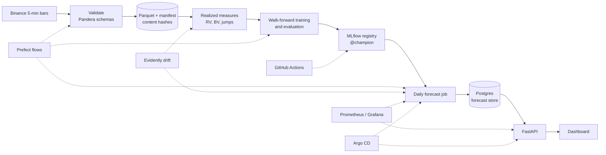

# Crypto Volatility Forecasting

Forecasting the **daily realized variance** of BTC, ETH and SOL from 5-minute Binance bars. Models are evaluated walk-forward against the HAR-RV benchmark using QLIKE loss, Diebold-Mariano tests, the Model Confidence Set and VaR backtests, and the system is shipped with MLflow, Prefect and Kubernetes. The repository is under active refinement (see the status below).

> **Notice: earlier results were retracted.** The first version of this project reported performance numbers that were invalid because of target leakage and other methodological defects. They have been removed. See [ADR-0002](docs/adr/0002-legacy-results-retracted.md) for the audit findings and evidence. The original code is preserved at git tag `v0-legacy` and in [`legacy/`](legacy/README.md).

## Architecture



A forecast for day t+1 uses only data up to the end of UTC day t. Details: [docs/architecture.md](docs/architecture.md).

## Quickstart

Requires [uv](https://docs.astral.sh/uv/) and Python 3.12.

```bash
uv sync --all-extras      # or: make setup
make test                 # fast tests (no network)
make data                 # ingest 5-min bars (SYMBOL=BTCUSDT START=2017-08-17)
make help                 # list all targets
```

## Repository layout

```
src/volforecast/   Package: data, features, models, evaluation, pipeline (backtest), registry, monitoring, flows, serving
tests/             Unit, property and integration tests (leakage guards live here)
configs/           Backtest configuration (configs/backtest.yaml)
docs/              Architecture, execution plan, platform guide, runbook, SLOs, model card
docs/adr/          Architecture decision records
legacy/            Frozen v0 code, kept for transparency (not linted, not supported)
notebooks/         Original exploratory notebook
deploy/            Helm chart, kind config, Argo CD manifests, monitoring (dashboards, alerts)
loadtest/          k6 load test
docker/, compose.yaml   Container images and local stack
.github/workflows/ CI and CD
Makefile           Developer entry points
```

Docs: [architecture](docs/architecture.md), [platform guide](docs/platform.md), [runbook](docs/runbook.md), [SLOs](docs/slo.md), [model card](docs/model_card.md).

## Roadmap and status

The full plan is in [docs/execution_plan.md](docs/execution_plan.md).

- [x] **M0** Repo foundation and honest baseline
- [x] **M1** Intraday data and realized measures
- [x] **M2** Baselines, walk-forward evaluation, statistical tests, report, regression gate
- [ ] **M3** ML/DL challengers, ensemble, interpretation (in progress: GBM, ensemble)
- [x] **M4** VaR / ES backtesting
- [ ] **M5** MLOps: MLflow, Prefect, forecast store, drift monitoring (in progress)
- [ ] **M6** Serving hardening and local stack (partial: images and compose done, real API pending)
- [ ] **M7** CI/CD, Kubernetes, Helm, GitOps (manifests done: Helm, kind, Argo CD, CD workflow; not yet run on a cluster)
- [ ] **M8** Observability, load testing, SRE docs (manifests done: dashboards, alerts, k6; runbook, SLOs and model card in `docs/`)
- [ ] **M9** Presentation and live dashboard (pending)

## Results

<!-- RESULTS:START -->
# Out-of-sample results

Walk-forward, expanding window, first origin 2021-01-01, min_train 365; benchmark HAR; QLIKE on variance (lower is better); ratio < 1 beats HAR. Models are compared on common valid origins (n shown per table). DM: one-sided HLN-corrected Diebold-Mariano p-value for 'model beats HAR'. MCS: Hansen-Lunde-Nason model confidence set at the 90% level (1000 bootstrap reps, seed 0). Where present, 'ratio vs log_har_dow' is the model's mean QLIKE divided by log_har_dow's and 'DM p (beats log_har_dow)' the one-sided HLN Diebold-Mariano p-value for 'model beats log_har_dow', on the same common origins (shown as - on the log_har_dow row).

## BTCUSDT

### h=1 (n=2135, origins 2021-01-01 to 2026-11-12)

| model | QLIKE | ratio vs HAR | DM p (beats HAR) | ratio vs log_har_dow | DM p (beats log_har_dow) | MSE | MZ R2 | MZ Wald p | MCS 90% |
|---|---|---|---|---|---|---|---|---|---|
| naive | 0.4964 | 1.368 | 1.000 | 1.690 | 1.000 | 6.075e-06 | 0.160 | 0.000 | no |
| ewma | 0.4138 | 1.141 | 0.943 | 1.409 | 1.000 | 4.340e-06 | 0.157 | 0.042 | no |
| ewma_rv | 0.4008 | 1.105 | 0.953 | 1.365 | 1.000 | 4.242e-06 | 0.166 | 0.534 | no |
| garch | 0.3921 | 1.081 | 0.999 | 1.335 | 1.000 | 4.266e-06 | 0.166 | 0.000 | no |
| gjr_garch | 0.3976 | 1.096 | 0.999 | 1.354 | 1.000 | 4.334e-06 | 0.151 | 0.001 | no |
| har (benchmark) | 0.3628 | 1.000 | - | 1.235 | 0.995 | 4.072e-06 | 0.211 | 0.000 | no |
| log_har | 0.3326 | 0.917 | 0.137 | 1.132 | 1.000 | 3.801e-06 | 0.253 | 0.177 | no |
| har_dow | 0.3780 | 1.042 | 0.921 | 1.287 | 0.996 | 4.144e-06 | 0.207 | 0.000 | no |
| log_har_dow | 0.2937 | 0.810 | 0.005 | - | - | 3.733e-06 | 0.266 | 0.322 | no |
| har_cj | 0.3726 | 1.027 | 1.000 | 1.268 | 0.998 | 4.299e-06 | 0.195 | 0.000 | no |
| shar | 0.4036 | 1.112 | 0.921 | 1.374 | 0.998 | 4.730e-06 | 0.158 | 0.000 | no |
| harq | 0.3305 | 0.911 | 0.000 | 1.125 | 0.940 | 4.051e-06 | 0.226 | 0.000 | no |
| lgbm | 0.2683 | 0.740 | 0.000 | 0.913 | 0.002 | 3.940e-06 | 0.243 | 0.000 | no |
| xgb | 0.2599 | 0.717 | 0.000 | 0.885 | 0.000 | 3.855e-06 | 0.254 | 0.000 | yes |
| ens_eq | 0.2934 | 0.809 | 0.000 | 0.999 | 0.491 | 3.851e-06 | 0.250 | 0.004 | no |
| ens_inv | 0.2907 | 0.801 | 0.000 | 0.990 | 0.408 | 3.847e-06 | 0.251 | 0.005 | no |

### h=5 (n=2103, origins 2021-01-01 to 2026-11-08)

| model | QLIKE | ratio vs HAR | DM p (beats HAR) | ratio vs log_har_dow | DM p (beats log_har_dow) | MSE | MZ R2 | MZ Wald p | MCS 90% |
|---|---|---|---|---|---|---|---|---|---|
| naive | 0.8464 | 3.082 | 0.999 | 3.682 | 1.000 | 1.070e-04 | 0.210 | 0.000 | no |
| ewma | 0.3015 | 1.098 | 0.782 | 1.312 | 1.000 | 4.710e-05 | 0.250 | 0.015 | no |
| ewma_rv | 0.2687 | 0.979 | 0.406 | 1.169 | 0.990 | 4.717e-05 | 0.256 | 0.050 | no |
| garch | 0.2588 | 0.942 | 0.063 | 1.126 | 0.913 | 4.614e-05 | 0.257 | 0.001 | no |
| gjr_garch | 0.2626 | 0.956 | 0.156 | 1.143 | 0.934 | 4.714e-05 | 0.240 | 0.009 | no |
| har (benchmark) | 0.2746 | 1.000 | - | 1.195 | 0.953 | 4.524e-05 | 0.297 | 0.000 | no |
| log_har | 0.2449 | 0.892 | 0.143 | 1.066 | 1.000 | 4.008e-05 | 0.368 | 0.016 | no |
| har_dow | 0.2672 | 0.973 | 0.000 | 1.163 | 0.918 | 4.490e-05 | 0.302 | 0.000 | no |
| log_har_dow | 0.2298 | 0.837 | 0.047 | - | - | 3.959e-05 | 0.376 | 0.022 | yes |
| har_cj | 0.2822 | 1.028 | 1.000 | 1.228 | 0.973 | 4.699e-05 | 0.288 | 0.000 | no |
| shar | 0.2711 | 0.987 | 0.015 | 1.179 | 0.942 | 4.686e-05 | 0.276 | 0.000 | no |
| harq | 0.2604 | 0.948 | 0.000 | 1.133 | 0.884 | 4.420e-05 | 0.314 | 0.000 | no |
| lgbm | 0.2289 | 0.834 | 0.001 | 0.996 | 0.477 | 4.229e-05 | 0.354 | 0.003 | no |
| xgb | 0.2195 | 0.799 | 0.000 | 0.955 | 0.258 | 4.052e-05 | 0.370 | 0.004 | yes |
| ens_eq | 0.2246 | 0.818 | 0.000 | 0.977 | 0.394 | 4.037e-05 | 0.366 | 0.000 | yes |
| ens_inv | 0.2252 | 0.820 | 0.000 | 0.980 | 0.400 | 4.038e-05 | 0.365 | 0.000 | yes |

## ETHUSDT

### h=1 (n=2135, origins 2021-01-01 to 2026-11-12)

| model | QLIKE | ratio vs HAR | DM p (beats HAR) | ratio vs log_har_dow | DM p (beats log_har_dow) | MSE | MZ R2 | MZ Wald p | MCS 90% |
|---|---|---|---|---|---|---|---|---|---|
| naive | 0.4208 | 1.209 | 0.973 | 1.575 | 1.000 | 2.643e-05 | 0.121 | 0.000 | no |
| ewma | 0.3759 | 1.080 | 0.801 | 1.407 | 1.000 | 1.792e-05 | 0.117 | 0.438 | no |
| ewma_rv | 0.3665 | 1.053 | 0.770 | 1.372 | 1.000 | 1.781e-05 | 0.125 | 0.462 | no |
| garch | 0.3891 | 1.118 | 1.000 | 1.456 | 1.000 | 1.729e-05 | 0.156 | 0.000 | no |
| gjr_garch | 0.3900 | 1.121 | 1.000 | 1.459 | 1.000 | 1.734e-05 | 0.154 | 0.000 | no |
| har (benchmark) | 0.3480 | 1.000 | - | 1.302 | 0.999 | 1.723e-05 | 0.165 | 0.000 | no |
| log_har | 0.2917 | 0.838 | 0.015 | 1.092 | 1.000 | 1.613e-05 | 0.205 | 0.618 | no |
| har_dow | 0.3100 | 0.891 | 0.000 | 1.160 | 0.944 | 1.714e-05 | 0.171 | 0.000 | no |
| log_har_dow | 0.2672 | 0.768 | 0.001 | - | - | 1.601e-05 | 0.210 | 0.696 | yes |
| har_cj | 0.3379 | 0.971 | 0.000 | 1.264 | 0.998 | 1.725e-05 | 0.162 | 0.000 | no |
| shar | 0.3478 | 1.000 | 0.490 | 1.302 | 0.999 | 1.794e-05 | 0.149 | 0.000 | no |
| harq | 0.3173 | 0.912 | 0.000 | 1.187 | 0.986 | 1.663e-05 | 0.183 | 0.001 | no |
| lgbm | 0.2570 | 0.738 | 0.000 | 0.962 | 0.228 | 1.667e-05 | 0.178 | 0.689 | yes |
| xgb | 0.2473 | 0.710 | 0.000 | 0.925 | 0.045 | 1.647e-05 | 0.187 | 0.930 | yes |
| ens_eq | 0.2664 | 0.766 | 0.000 | 0.997 | 0.480 | 1.617e-05 | 0.202 | 0.052 | yes |
| ens_inv | 0.2648 | 0.761 | 0.000 | 0.991 | 0.425 | 1.615e-05 | 0.204 | 0.079 | no |

### h=5 (n=2103, origins 2021-01-01 to 2026-11-08)

| model | QLIKE | ratio vs HAR | DM p (beats HAR) | ratio vs log_har_dow | DM p (beats log_har_dow) | MSE | MZ R2 | MZ Wald p | MCS 90% |
|---|---|---|---|---|---|---|---|---|---|
| naive | 0.6454 | 2.257 | 0.998 | 2.916 | 1.000 | 4.574e-04 | 0.167 | 0.000 | no |
| ewma | 0.2874 | 1.005 | 0.518 | 1.299 | 1.000 | 1.828e-04 | 0.189 | 0.117 | no |
| ewma_rv | 0.2605 | 0.911 | 0.156 | 1.177 | 0.999 | 1.853e-04 | 0.204 | 0.057 | no |
| garch | 0.3043 | 1.064 | 0.998 | 1.375 | 1.000 | 1.791e-04 | 0.239 | 0.000 | no |
| gjr_garch | 0.3053 | 1.068 | 0.998 | 1.380 | 1.000 | 1.798e-04 | 0.237 | 0.000 | no |
| har (benchmark) | 0.2860 | 1.000 | - | 1.292 | 0.995 | 1.713e-04 | 0.259 | 0.000 | no |
| log_har | 0.2323 | 0.812 | 0.020 | 1.050 | 1.000 | 1.539e-04 | 0.317 | 0.034 | no |
| har_dow | 0.2810 | 0.982 | 0.000 | 1.270 | 0.991 | 1.706e-04 | 0.263 | 0.000 | no |
| log_har_dow | 0.2213 | 0.774 | 0.005 | - | - | 1.525e-04 | 0.323 | 0.055 | yes |
| har_cj | 0.2863 | 1.001 | 0.652 | 1.294 | 0.995 | 1.739e-04 | 0.253 | 0.000 | no |
| shar | 0.2834 | 0.991 | 0.011 | 1.281 | 0.994 | 1.726e-04 | 0.254 | 0.000 | no |
| harq | 0.2754 | 0.963 | 0.000 | 1.245 | 0.986 | 1.712e-04 | 0.257 | 0.000 | no |
| lgbm | 0.2253 | 0.788 | 0.000 | 1.018 | 0.602 | 1.689e-04 | 0.273 | 0.002 | no |
| xgb | 0.2165 | 0.757 | 0.000 | 0.979 | 0.381 | 1.652e-04 | 0.281 | 0.005 | yes |
| ens_eq | 0.2229 | 0.780 | 0.000 | 1.007 | 0.533 | 1.586e-04 | 0.303 | 0.000 | yes |
| ens_inv | 0.2220 | 0.776 | 0.000 | 1.003 | 0.516 | 1.587e-04 | 0.302 | 0.000 | yes |

## SOLUSDT

### h=1 (n=1917, origins 2021-08-10 to 2026-11-11)

| model | QLIKE | ratio vs HAR | DM p (beats HAR) | ratio vs log_har_dow | DM p (beats log_har_dow) | MSE | MZ R2 | MZ Wald p | MCS 90% |
|---|---|---|---|---|---|---|---|---|---|
| naive | 0.3267 | 1.018 | 0.594 | 1.445 | 1.000 | 3.558e-05 | 0.321 | 0.000 | no |
| ewma | 0.3524 | 1.098 | 0.942 | 1.559 | 1.000 | 3.683e-05 | 0.109 | 0.000 | no |
| ewma_rv | 0.3615 | 1.126 | 0.974 | 1.599 | 1.000 | 3.720e-05 | 0.098 | 0.172 | no |
| garch | 0.3101 | 0.966 | 0.051 | 1.372 | 1.000 | 3.285e-05 | 0.203 | 0.007 | no |
| gjr_garch | 0.3099 | 0.966 | 0.050 | 1.371 | 1.000 | 3.287e-05 | 0.203 | 0.007 | no |
| har (benchmark) | 0.3210 | 1.000 | - | 1.420 | 1.000 | 2.952e-05 | 0.304 | 0.000 | no |
| log_har | 0.2432 | 0.758 | 0.000 | 1.076 | 1.000 | 2.824e-05 | 0.312 | 0.669 | no |
| har_dow | 0.2967 | 0.924 | 0.000 | 1.312 | 1.000 | 2.933e-05 | 0.309 | 0.000 | no |
| log_har_dow | 0.2261 | 0.704 | 0.000 | - | - | 2.788e-05 | 0.321 | 0.638 | yes |
| har_cj | 0.3241 | 1.010 | 1.000 | 1.434 | 1.000 | 2.980e-05 | 0.298 | 0.000 | no |
| shar | 0.3206 | 0.999 | 0.224 | 1.418 | 1.000 | 2.969e-05 | 0.299 | 0.000 | no |
| harq | 0.2735 | 0.852 | 0.000 | 1.209 | 1.000 | 2.828e-05 | 0.322 | 0.000 | no |
| lgbm | 0.2209 | 0.688 | 0.000 | 0.977 | 0.219 | 2.748e-05 | 0.332 | 0.007 | yes |
| xgb | 0.2196 | 0.684 | 0.000 | 0.971 | 0.161 | 2.765e-05 | 0.328 | 0.015 | yes |
| ens_eq | 0.2330 | 0.726 | 0.000 | 1.031 | 0.928 | 2.701e-05 | 0.346 | 0.000 | no |
| ens_inv | 0.2309 | 0.719 | 0.000 | 1.021 | 0.851 | 2.700e-05 | 0.346 | 0.000 | yes |

### h=5 (n=1903, origins 2021-08-13 to 2026-11-07)

| model | QLIKE | ratio vs HAR | DM p (beats HAR) | ratio vs log_har_dow | DM p (beats log_har_dow) | MSE | MZ R2 | MZ Wald p | MCS 90% |
|---|---|---|---|---|---|---|---|---|---|
| naive | 0.4649 | 1.403 | 1.000 | 2.019 | 1.000 | 9.844e-04 | 0.148 | 0.000 | no |
| ewma | 0.3361 | 1.014 | 0.543 | 1.460 | 0.999 | 4.865e-04 | 0.094 | 0.000 | no |
| ewma_rv | 0.3185 | 0.961 | 0.382 | 1.384 | 0.994 | 4.817e-04 | 0.102 | 0.000 | no |
| garch | 0.2623 | 0.792 | 0.000 | 1.139 | 0.999 | 4.526e-04 | 0.162 | 0.004 | no |
| gjr_garch | 0.2627 | 0.793 | 0.000 | 1.141 | 0.999 | 4.552e-04 | 0.161 | 0.003 | no |
| har (benchmark) | 0.3313 | 1.000 | - | 1.439 | 1.000 | 4.797e-04 | 0.194 | 0.000 | no |
| log_har | 0.2402 | 0.725 | 0.000 | 1.043 | 1.000 | 4.263e-04 | 0.195 | 0.002 | no |
| har_dow | 0.3271 | 0.987 | 0.015 | 1.421 | 1.000 | 4.775e-04 | 0.197 | 0.000 | no |
| log_har_dow | 0.2302 | 0.695 | 0.000 | - | - | 4.200e-04 | 0.205 | 0.007 | yes |
| har_cj | 0.3320 | 1.002 | 0.747 | 1.442 | 1.000 | 4.737e-04 | 0.200 | 0.000 | no |
| shar | 0.3318 | 1.001 | 0.948 | 1.441 | 1.000 | 4.883e-04 | 0.186 | 0.000 | no |
| harq | 0.3011 | 0.909 | 0.000 | 1.308 | 1.000 | 4.512e-04 | 0.216 | 0.000 | no |
| lgbm | 0.2597 | 0.784 | 0.000 | 1.128 | 0.999 | 4.534e-04 | 0.203 | 0.000 | no |
| xgb | 0.2541 | 0.767 | 0.000 | 1.104 | 0.997 | 4.495e-04 | 0.204 | 0.000 | no |
| ens_eq | 0.2526 | 0.762 | 0.000 | 1.097 | 0.996 | 4.242e-04 | 0.221 | 0.000 | no |
| ens_inv | 0.2506 | 0.756 | 0.000 | 1.088 | 0.996 | 4.250e-04 | 0.219 | 0.000 | no |
<!-- RESULTS:END -->

## Limitations

- Volatility forecasts are statistical estimates and can be wrong, especially during regime changes and market stress.
- Data comes from a single venue (Binance); other venues may differ.
- Results, once available, describe past out-of-sample behaviour and do not guarantee future performance.
- The legacy code in `legacy/` is known to be flawed and must not be used for conclusions.

**This project is for research and education only. It is not investment advice.**
