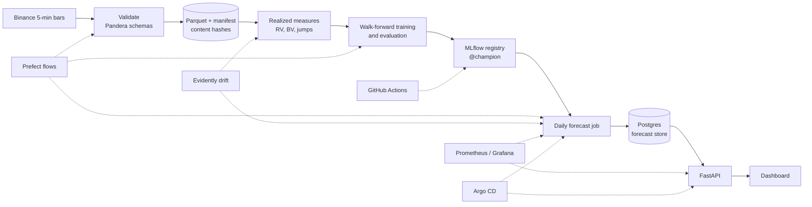

# Crypto Volatility Forecasting

Forecasting the **daily realized variance** of BTC, ETH and SOL from 5-minute Binance bars. Models are evaluated walk-forward against the HAR-RV benchmark using QLIKE loss, Diebold-Mariano tests, the Model Confidence Set and VaR backtests, and the system is shipped with MLflow, Prefect and Kubernetes. The repository is under active refinement (see the status below).

> **Notice: earlier results were retracted.** The first version of this project reported performance numbers that were invalid because of target leakage and other methodological defects. They have been removed. See [ADR-0002](docs/adr/0002-legacy-results-retracted.md) for the audit findings and evidence. The original code is preserved at git tag `v0-legacy` and in [`legacy/`](legacy/README.md).

## Architecture



A forecast for day t+1 uses only data up to the end of UTC day t. Details: [docs/architecture.md](docs/architecture.md).

## Quickstart

Requires [uv](https://docs.astral.sh/uv/) and Python 3.12.

```bash
uv sync --all-extras      # or: make setup
make test                 # fast tests (no network)
make data                 # ingest 5-min bars (SYMBOL=BTCUSDT START=2017-08-17)
make help                 # list all targets
```

## Repository layout

```
src/volforecast/   Package: data, features, models, evaluation, registry, monitoring, flows, serving
tests/             Unit, property and integration tests (leakage guards live here)
docs/              Architecture, execution plan, ADRs
docs/adr/          Architecture decision records
legacy/            Frozen v0 code, kept for transparency (not linted, not supported)
notebooks/         Original exploratory notebook
deploy/            Helm chart, kind config, Argo CD manifests (added in later milestones)
docker/, compose.yaml   Container images and local stack
.github/workflows/ CI
Makefile           Developer entry points
```

## Roadmap and status

The full plan is in [docs/execution_plan.md](docs/execution_plan.md).

- [ ] **M0** Repo foundation and honest baseline (in progress)
- [ ] **M1** Intraday data and realized measures
- [ ] **M2** Baselines, walk-forward evaluation, statistical tests
- [ ] **M3** ML/DL challengers, ensemble, interpretation
- [ ] **M4** VaR / ES backtesting
- [ ] **M5** MLOps: MLflow, Prefect, drift monitoring
- [ ] **M6** Serving hardening and local stack
- [ ] **M7** CI/CD, Kubernetes, Helm, GitOps
- [ ] **M8** Observability, load testing, SRE docs
- [ ] **M9** Presentation and live dashboard

## Results

<!-- RESULTS:START -->
Results are generated by `make report`; none yet.
<!-- RESULTS:END -->

## Limitations

- Volatility forecasts are statistical estimates and can be wrong, especially during regime changes and market stress.
- Data comes from a single venue (Binance); other venues may differ.
- Results, once available, describe past out-of-sample behaviour and do not guarantee future performance.
- The legacy code in `legacy/` is known to be flawed and must not be used for conclusions.

**This project is for research and education only. It is not investment advice.**
