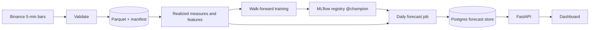

# Architecture

This document describes the target architecture. Components arrive milestone by milestone; see the [execution plan](execution_plan.md) and the [ADRs](adr/README.md).

## Components

| Component | Responsibility | Code / config |
|-----------|----------------|---------------|
| Ingestion | Download 5-minute klines from data.binance.vision, verify checksums | `src/volforecast/data/` |
| Validation | Pandera schemas for klines, daily realized variance, features; missing-bar policy ([ADR-0003](adr/0003-missing-bar-policy.md)) | `src/volforecast/data/` |
| Storage | Partitioned Parquet with a manifest of SHA-256 content hashes ([ADR-0004](adr/0004-parquet-manifest-over-dvc.md)); DuckDB reads | `src/volforecast/data/store.py` |
| Realized measures | RV, bipower variation, jumps, semivariances; HAR aggregates | `src/volforecast/features/` |
| Models | HAR-RV baseline, naive, EWMA, GARCH, gradient boosting, LSTM/PatchTST, ensemble | `src/volforecast/models/` |
| Evaluation | Walk-forward engine, QLIKE/MSE/MAE, Diebold-Mariano, Mincer-Zarnowitz, MCS, VaR/ES backtests | `src/volforecast/evaluation/` |
| Registry | MLflow tracking; `@champion` / `@challenger` aliases ([ADR-0006](adr/0006-mlflow-aliases-over-stages.md)) | `src/volforecast/registry/` |
| Orchestration | Prefect flows triggered by Kubernetes CronJobs ([ADR-0007](adr/0007-cronjob-triggers-prefect-executes.md)) | `src/volforecast/flows/` |
| Forecast store | Postgres table of daily forecasts with model version and data manifest hash ([ADR-0009](adr/0009-batch-inference-forecast-store.md)) | `src/volforecast/serving/store.py` |
| API | FastAPI `/v1`, reads the forecast store only | `src/volforecast/serving/` |
| Monitoring | Evidently drift reports, Prometheus metrics, Grafana dashboards | `src/volforecast/monitoring/`, `deploy/monitoring/` |
| Delivery | GitHub Actions CI; Argo CD GitOps ([ADR-0010](adr/0010-gitops-argocd-pull.md)) | `.github/workflows/`, `deploy/` |

## Data flow

1. Ingest and validate bars; days failing the completeness policy are flagged.
2. Persist as partitioned Parquet; the manifest pins the exact data used by any run.
3. Compute daily realized measures and features.
4. Train and evaluate walk-forward; log runs to MLflow; promote a challenger only through the gated step.
5. The daily job loads `@champion`, forecasts all assets, and writes to the forecast store.
6. The API and dashboard read from the store.

## Information-set rule

A forecast for day t+1 uses only data available at or before the end of UTC day t. Concretely:

- Features for the forecast date are computed from bars with timestamps up to 23:55 UTC (bar close 00:00 UTC) of day t.
- Targets are realized variance of day t+1 and are never visible to training or feature code for that forecast.
- Preprocessing (scalers, imputation) and hyperparameter tuning ([ADR-0005](adr/0005-tuning-inside-walk-forward.md)) are fitted only on data inside the training window.
- Backward fills are not allowed; missing-bar handling follows ADR-0003.
- Leakage-guard tests (shifting future data must not change past forecasts) enforce this rule in CI.

The legacy system violated this rule ([ADR-0002](adr/0002-legacy-results-retracted.md)).
